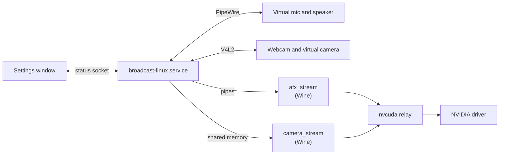
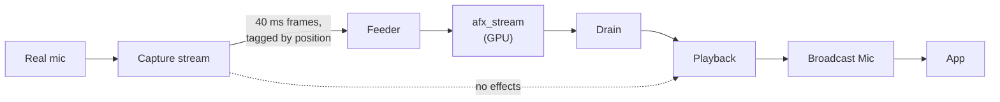
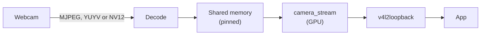

# Architecture

A Rust service owns the Linux devices. Two small Wine workers run NVIDIA's effects on
the GPU.

| Part | Role |
|---|---|
| `broadcast-linux run` | systemd user service. Starts a worker when an app uses a device, stops it when idle |
| `broadcast-linux-gui` | Settings window |
| `afx_stream.exe` | NVIDIA Audio Effects on 40 ms mono frames |
| `camera_stream.exe` | NVIDIA Video Effects and AR SDK |
| nvcuda relay | Patched Wine nvcuda that forwards CUDA to the Linux driver |
| `broadcast-linux setup` | Downloads NVIDIA Broadcast and prepares the Wine prefix |

## Audio

- **One clock:** capture and the virtual node share a PipeWire node group, so they never drift.
- **Fixed delay:** one 40 ms frame plus the reserve, less half a period. A late frame becomes a short gap, not extra delay.
- **Reserve:** worker time per frame, in 5.3 ms periods (256 samples):
  - 2 for the first 10 s, and after any round trip over 3 ms (GPU in a low power state or busy with the camera)
  - 1 after 10 s of round trips under 2 ms
  - 3 always for Studio Voice, which takes up to about 12 ms on every other frame
  - 4 always for Studio Voice with a mic profile, which takes up to about 19 ms

  Changes are spread over about a third of a second.
- **Half a period less:** a 1920-sample frame ends half way into a period or at its end, and reaches the worker with that period, so every frame still gets the whole reserve. [Benchmark](benchmark.md#audio-delay-ms) has other period sizes.
- **GPU kept awake:** with only audio running, the GPU switches power states, and a frame near a switch can take 25 ms. Clearing 128 MB of GPU memory after each frame usually holds a middle power state, at a little more power.
- **Silence until unload:** after the last app leaves, the model runs on silence until `unload_after_minutes` (default 2). An idle GPU stalls 20 to 30 ms when audio returns. `gpu_keep_awake = false` turns off this and the bullet above.
- **Speaker:** the same pipeline, from apps to the real output.

## Camera

- **Decode:** libjpeg-turbo straight to planar YUV, on several cores above 1080p30.
- **Slow GPU:** if the effects take longer than a webcam frame, the next frame is decoded just before the GPU is free, so it doesn't wait in line.
- **Output:** written straight into the loopback's buffers with v4l2loopback 0.14+ and `max_buffers=3`. With Frame Generation, the service copies each frame in and spreads the made frames evenly between webcam frames.
- **Idle:** a placeholder frame keeps the virtual camera listed.
- **New size:** apps that hold the virtual camera at the old size across a restart get a black frame five times a second, so they don't stall. Once they close it, the service reopens it at the new size.

## File Processor

`broadcast-linux process` and the Files page run the same workers on files, with ffmpeg on both ends.

- **Video:** ffmpeg decodes to BGR24 at a constant frame rate, `camera_stream` reads it from a pipe, and ffmpeg encodes its YUYV output to H.264.
- **Audio:** ffmpeg decodes to 48 kHz float. Each channel gets its own `afx_stream`, and the effect's delay is cut from the start, so the sound stays in sync with the video.
- **Output:** written under a hidden temporary name beside the result, then renamed without replacing any file.

## Latency

Measured delay, CPU and GPU power, on Linux and on Windows with NVIDIA Broadcast:
see [Benchmark](benchmark.md).
